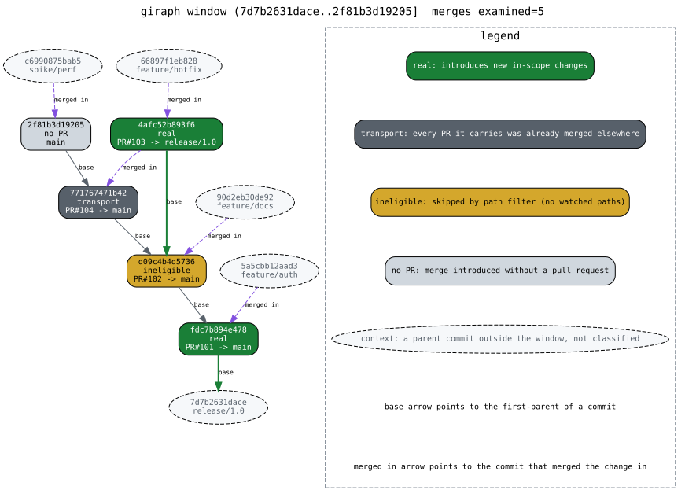
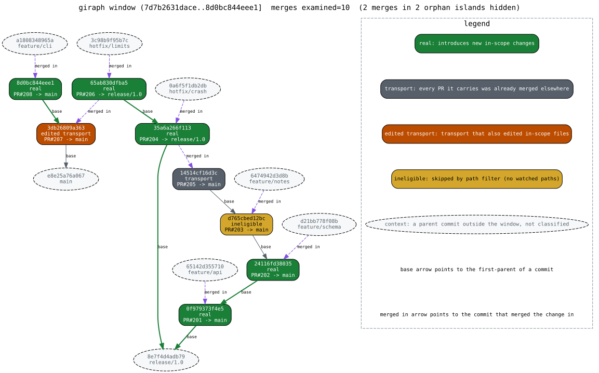

# giraph

> _pronounced gi-raff with a hard 'g'_

Give it two commit SHAs. giraph walks the merge graph between them and classifies each
merge as a **real** change or **transport** noise — so you can audit what genuinely new work
landed in a range without double-counting PRs merely carried across from another branch. It
renders the result as a graph (SVG or DOT) plus a decision table.

> **Scope:** giraph only understands **merge-commit workflows** — its model needs a
> real second parent. Squash/rebase histories and plain non-merge commits are not examined.

## Install

```bash
uv sync
```

SVG output (the default) needs graphviz — the `dot` binary must be on your PATH.

giraph needs **git >= 2.38** (it uses `git merge-tree --write-tree` to detect a merge's own conflict
resolution). Run against a **full clone** — shallow clones hide the release-branch ancestry giraph
walks, and giraph warns when it is pointed at one. On a large repository, `git commit-graph write
--reachable` first: every merge walks ancestry, and the commit-graph is what keeps that cheap.

giraph ignores `GIT_DIR` and the other `GIT_*` location variables in your environment: `--repo` is
the only thing that selects the repository it reads.

## Usage

```bash
uv run giraph <from-sha> <to-sha> --repo /path/to/checkout
```

`<from-sha>` is the **exclusive** lower bound; `<to-sha>` the **inclusive** upper bound.

By default (`--format svg|dot`) the decision **table** prints to stderr and the **graph** to
stdout; with `--format table` the table prints to stdout and no graph is produced. Options:

| flag | effect |
|---|---|
| `--repo DIR` | path inside the checkout to read (default `.`); its repo root is discovered upward, as git does |
| `--format svg\|dot\|table` | stdout artifact; default `svg` (SVG needs graphviz `dot` on PATH) |
| `--output FILE` | write the graph to `FILE` instead of stdout |
| `--convention NAME` | how to read merge messages (see [Conventions](#conventions)) |
| `--eligible-path P` | repeatable; path prefix that makes a merge eligible |
| `--config FILE` | config path (default `<repo>/giraph.toml`) |
| `--strict` | require `<from>` on `<to>`'s first-parent chain |
| `--drop-orphan-islands` / `--no-drop-orphan-islands` | hide (or force-show) graph clusters with no PR-matched merge; the `--no-` form overrides a config `true` |
| `--merged-in-arrow in\|out` | direction of the dashed `merged in` edge; `in` = into the merge (default) |

## Classification

Two config-driven notions drive every decision (both under [Configuration](#configuration)): an
**accepted ref** is a target branch giraph treats as a real integration target (e.g. `main`,
`release/*`); **eligible paths** are the path prefixes whose changes you care about (e.g. `src/`).

Each merge gets one class. giraph first matches it to a PR into an accepted ref (else
`no PR`), then reads the merge graph to decide `transport`/`edited transport`/`real`; a
`real` merge that touched no eligible paths is then downgraded to `ineligible`. Anything that
raises mid-classification becomes `error`.

| class | meaning |
|---|---|
| `real` | intrinsic PR merge into an accepted ref that touched eligible paths |
| `transport` | its incoming side terminates in PR merges into accepted refs, so every PR it carries was reviewed elsewhere |
| `edited transport` | transport, but the merge's own conflict resolution edited eligible paths — worth attention |
| `ineligible` | an intrinsic (non-transport) PR merge that touched no eligible paths |
| `no PR` | a merge with no recognizable PR into an accepted ref |
| `error` | classification could not complete |

> **Known limitation.** `transport` is decided from the PR merges terminating the incoming side, not
> from a proof that the incoming side carries *nothing else*. In the protected-branch workflow giraph
> is built for — every change onto an accepted ref arrives through a PR — the only way a carrier can
> gain unreviewed work is the merge's own conflict resolution, which is exactly what `edited
> transport` catches. On a history where people push straight to a carried branch, a `transport`
> verdict can hide those direct commits.

## Example output

giraph renders a window like this:



A merge's **first parent** is its *base* (the branch merged onto); its **second parent** is what
was *merged in* (the incoming tip). Each node is a merge coloured by class; the solid `base` edge
points backward to the first parent and the dashed `merged in` edge points into the merge — the
baked-in legend spells both out, along with the window range.

Dashed grey **ellipses** are *context*: parent commits that fall outside the window, so giraph never
classified them. They are drawn only to anchor the merges that point at them, labelled with the
branch `git name-rev` gives them.

A larger, real-world-shaped window — a `main` branch fed by `release` back-merges, rendered with
`--drop-orphan-islands` to hide the feature-branch churn:



Both images are generated from throwaway git repositories built by
[`scripts/generate_examples.py`](scripts/generate_examples.py) (`make examples`), so every SHA in
them is real and reproducible.

## Conventions

giraph reads PR metadata from each merge commit's **own message** — offline, no network.
A convention says how to parse that message; pick one with `convention` in config or `--convention`:

- **plain** (default) — git's own `Merge branch 'x' into Y`. Host-neutral.
- **bitbucket** — Bitbucket Server merges (`Pull request #N:` + `Merge in … to <ref>`,
  `Automatic merge from … -> <ref>`, legacy `Merge pull request #N in …`); falls back to `plain`.
- **gitlab** — GitLab MRs (`Merge branch 'src' into 'target'` + a `See merge request …!N`
  trailer); falls back to `plain`.

git omits the ` into <ref>` suffix when you merge onto the default branch, so `Merge branch 'x'`
arrives with no target in it at all. Every convention parses that bare form, and giraph attributes it
to the **accepted ref whose first-parent spine holds the merge** — the ref it was merged onto. When no
accepted ref names the merge that way the attribution would be a guess, so the merge stays `no PR`.

To add a host, write a `MergeConvention` subclass in `providers/conventions.py` and
register it in `CONVENTIONS`.

## Configuration

Discovered at the **repo root** as `giraph.toml` (or `--config`); CLI flags override the file, and an
unrecognized key is an error rather than a silent no-op. Copy `giraph.toml.example` to get started.
Note the file is read from the repository under examination — giraph logs which one it used.

```toml
[giraph]
eligible_paths = ["src/", "lib/"]           # empty = every PR merge is eligible
accept_target_refs = ["main"]               # a merge must target one of these refs…
accept_target_ref_prefixes = ["release/"]   # …or a ref with one of these prefixes
convention = "bitbucket"
drop_orphan_islands = false                  # hide graph clusters with no PR-matched merge
merged_in_arrow = "in"                       # dashed edge: "in" (into merge) or "out" (to its tip)
```

`drop_orphan_islands` declutters the graph by dropping any drawn component that contains no
`real`/`transport`/`edited transport`/`ineligible` merge — i.e. isolated clusters of feature-branch
`no PR` churn that never fed a tracked-ref PR. It affects the graph only; the decision table stays
complete, and the window label notes how many merges were hidden.

With `eligible_paths` empty every path is in scope: no merge is downgraded to `ineligible`, and any
merge-introduced resolution still shows up as `edited transport`.

## Exit codes

| code | meaning |
|---|---|
| `0` | ran successfully; every merge classified and at least one matched a PR |
| `1` | setup/runtime failure (bad config, missing `dot`, git error, unwritable `--output`) |
| `2` | invalid command-line usage (from argparse) |
| `3` | classification completed but at least one merge classified as `error` |
| `4` | nothing to audit: the window held no merges, or no merge matched a PR into an accepted ref |

Exit `4` exists because an all-`no PR` window is what a wrong `convention` or `accept_target_refs`
looks like, and that is indistinguishable from a genuine finding. giraph refuses to call it a
success; the warning on stderr says which setting to check.

## Library API

Everything the CLI does is available from `giraph` itself — [`scripts/generate_examples.py`](scripts/generate_examples.py)
is a working example.

```python
from pathlib import Path

from giraph import (
    Classifier,
    Config,
    GitRepo,
    MessageProvider,
    get_convention,
    name_rev_patterns,
    render_report,
)

repo = GitRepo.discover(Path("/path/to/checkout"))
config = Config(
    eligible_paths=("src/",),
    accept_refs=("main",),
    accept_prefixes=("release/",),
    convention="bitbucket",
    drop_orphan_islands=False,
    merged_in_arrow="in",
)
report = Classifier(
    provider=MessageProvider(
        repo=repo,
        convention=get_convention(config.convention),
        attribute_refs=name_rev_patterns(config),  # lets bare "Merge branch 'x'" be attributed
    ),
    repo=repo,
    eligible_paths=config.eligible_paths,
    accept_refs=config.accept_refs,
    accept_prefixes=config.accept_prefixes,
).run("<from-sha>", "<to-sha>")

print(report.summary_line())
svg = render_report(report, repo=repo, config=config, fmt="svg")
```

| export | purpose |
|---|---|
| `Classifier` | the engine; `.run(from, to)` returns a `Report` |
| `Report`, `Outcome`, `PullRequest` | result types; `Report.count(cls)`, `Report.matched_count()`, `Report.summary_line()` |
| `REAL`, `TRANSPORT`, `MIXED`, `INELIGIBLE`, `UNMATCHED`, `ERROR`, `TRACKED_CLASSES`, `Classification` | the classes an `Outcome` can carry |
| `GitRepo` | git access; `GitRepo.discover(path)` finds the repo root |
| `MessageProvider`, `PullRequestProvider` | PR metadata; subclass `PullRequestProvider._fetch` to query a host API instead of commit messages |
| `MergeConvention`, `CONVENTIONS`, `get_convention` | merge-message parsing |
| `Config`, `CONFIG_FILENAME`, `find_config`, `load_config`, `resolve_config`, `name_rev_patterns` | the CLI's config pipeline |
| `render_report`, `to_dot`, `to_svg`, `decisions_table` | rendering |
| `GiraphError` | the only exception giraph raises deliberately |

## Development

```bash
make check      # ruff check + ruff format --check + ty + pytest
make fix        # autofix lint + format
make examples   # rebuild example.svg and example-complex.svg (needs graphviz)
```
